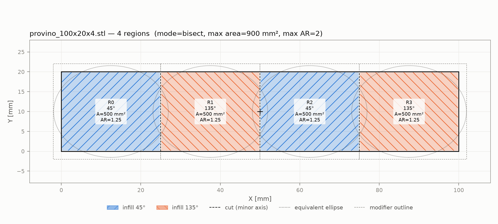
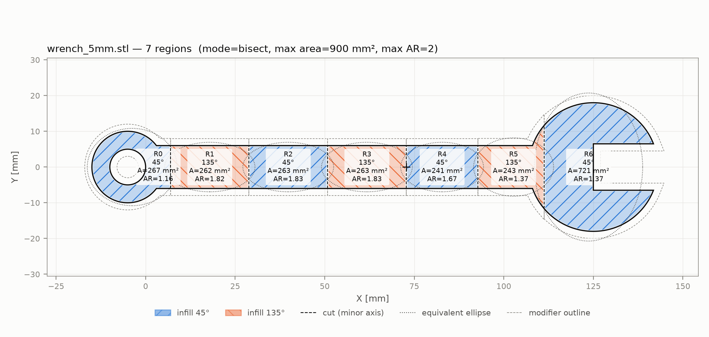
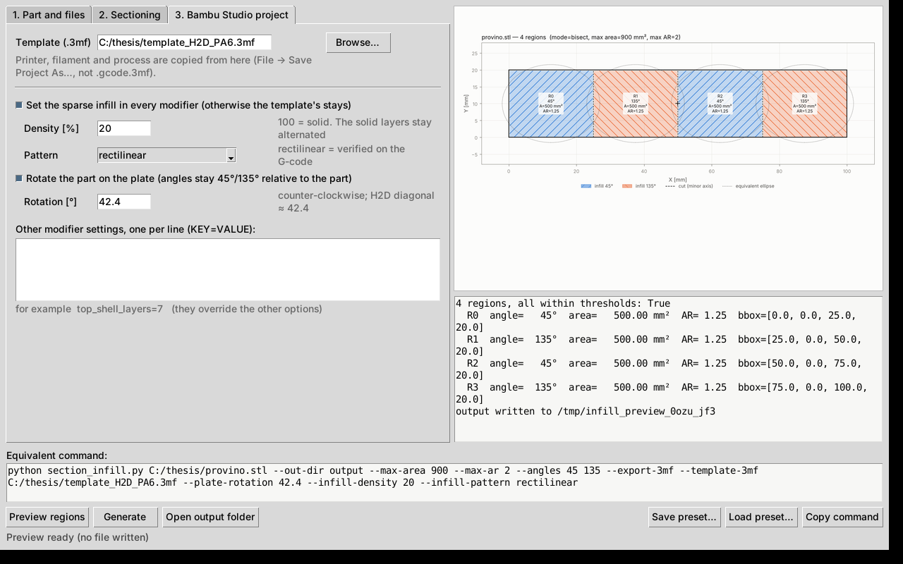

# prova_bricking: infill sectioning against warping

Python implementation of the infill sectioning criterion proposed by
**Shen, Veeramani, Qin (2026)**, *"Warpage mitigation through infill sectioning in
fused filament fabrication"*, IISE Transactions 58(1):57-69.

The program reads the 3D model of a **2.5D** part (constant cross-section along Z:
plates, test specimens, wrenches) as STL or STEP and does the following:

1. extracts the XY footprint of the part;
2. computes its image moments: area, centroid, principal axes and equivalent
   ellipse, with aspect ratio AR = major axis / minor axis;
3. recursively bisects the footprint **along the minor axis, through the centroid**,
   until every sub-region has `area ≤ max_area` **and** `AR ≤ max_ar`;
4. gives neighbouring regions alternating infill angles (45°/135°);
5. writes a JSON report, a PNG check image and **one STL file per sub-region**, to be
   used as *modifiers* in Bambu Studio;
6. with `--export-3mf`, also writes a **ready Bambu Studio project (.3mf)**: part and
   modifiers already assembled, modifiers already of type "Modifier", and
   `infill_direction` already set (alternating 45°/135°).

**Step-by-step guide, recipes and troubleshooting: [USER_GUIDE.txt](USER_GUIDE.txt)**
(Italian version: [GUIDA_USO.txt](GUIDA_USO.txt)).




---

## Installation

```bash
python -m venv .venv && source .venv/bin/activate      # Windows: .venv\Scripts\activate
pip install -r requirements.txt
pip install cadquery-ocp         # only to read STEP files (OpenCascade kernel)
```

Python ≥ 3.10 is required. `cadquery-ocp` is optional: without it the program still
works on STL, OBJ, PLY, 3MF and similar files.

## Graphical interface

If you prefer not to type commands:

```bash
python section_infill_gui.py
```



The window has three tabs:
1. **Part and files**: model (STL or STEP), output folder, prefix, and what to write
   (PNG, modifier STLs, `.3mf` project).
2. **Sectioning**: maximum area and aspect ratio, the two angles, the **third angle,
   only where needed** checkbox and, under *Advanced*, mode, footprint, minimum area,
   depth and modifier margins.
3. **Bambu Studio project**: template, the **Set the sparse infill** checkbox (density
   and pattern, chosen among the Bambu patterns), the **Rotate the part on the plate**
   checkbox (with the degrees) and a box for other modifier settings, one per line
   (`top_shell_layers=7`).

Unticked checkboxes write nothing: the related fields are greyed out and the
corresponding option does not appear in the command. If you untick *Set the sparse
infill*, the modifiers do not touch density and pattern, which stay those of the
template.

The buttons:
- **Preview regions** computes the sectioning and shows it in the window, without
  writing any file in the output folder;
- **Generate** writes the files; the log appears at the bottom right;
- **Copy command** copies the equivalent terminal command (shown at the bottom and
  updated at every change): it lets you repeat a run and document it in the thesis;
- **Save preset… / Load preset…** save and reload all the fields in a `.json` file
  (for example one per DOE condition). At start-up the window reopens the last
  configuration used (`~/.infill_sectioning_gui.json`).

The fields are checked before running: a wrong number, two equal angles, a density
outside 0–100, a file that does not exist or a setting without `=` give a list of
errors and nothing runs.

`tkinter` is included in Python on Windows and macOS. On Linux:
`sudo apt install python3-tk`. The window runs the same `section_infill.py`, so the
result is identical to the terminal's.

### Using Visual Studio Code (Run button)

The repository contains a `.vscode` folder, so the window can be opened from VS Code
with the Run button:

1. Install [Visual Studio Code](https://code.visualstudio.com/) and its **Python**
   extension (VS Code offers it when you open the folder).
2. **File → Open Folder…** and choose the program folder (the one containing
   `section_infill_gui.py`).
3. Choose the Python to use: `Ctrl+Shift+P` → **Python: Select Interpreter**. The one
   you choose is shown at the bottom right.
4. Install the libraries **for that interpreter**: `Terminal → Run Task… →
   Install dependencies` (it runs `pip install -r requirements.txt` with the
   selected interpreter).
5. Open `section_infill_gui.py` and click the **▶ Run Python File** button at the top
   right of the editor. The window opens.

You can also press **F5** (or open *Run and Debug*) and choose **Open the GUI**: this
works whichever file is open. The other launch configurations ask you for the paths:
*Section a model*, *Check a G-code*, *Run the tests*. `Terminal → Run Task…` has
*Open the GUI* and *Run the tests* too, and the **Testing** view lists the pytest
tests.

If a library is missing for the selected interpreter, the program does not stop with a
traceback: it shows a message with the exact command to type for that Python (this is
the most common problem when the interpreter selected in VS Code is not the one where
`pip install` was run).

Notes: the `.vscode` files are plain configuration. I could not run VS Code itself in
the cloud session where they were written, only check the JSON and start the script from
another working folder: if a menu name differs in your version, the same commands can be
run from the integrated terminal. If very long OneDrive paths (with spaces and
apostrophes) misbehave, copy the program to a short folder such as `C:\infill`.

## Command line

```bash
python section_infill.py specimen.stl --max-area 900 --max-ar 2.0 --out-dir ./output
python section_infill.py specimen.step --out-dir ./output          # STEP (needs cadquery-ocp)
```

| Option | Default | Meaning |
|---|---|---|
| `--max-area` | 900 | maximum area of a sub-region [mm²] |
| `--max-ar` | 2.0 | maximum aspect ratio of the equivalent ellipse |
| `--mode` | `bisect` | `bisect` is the method of Shen et al.; `nsplit` is **experimental** (see below) |
| `--angles A1 A2` | 45 135 | the two infill angles to alternate [°] |
| `--extra-angle DEG` | (not used) | third angle, used **only** if two angles are not enough (T-junctions) and on as few regions as possible; for example `90` |
| `--margin-xy` | 2.0 | how far the modifiers extend beyond the outer walls of the part [mm] |
| `--margin-z` | 1.0 | how far the modifiers extend above the part [mm] |
| `--footprint` | `projection` | `projection` = shadow of the mesh on XY; `section` = cross-section at mid height |
| `--min-area` | 1.0 | below this area [mm²] a region is not bisected any more (safety stop) |
| `--max-depth` | 12 | maximum recursion depth |
| `--step-tolerance` | 0.05 | linear deflection of the STEP tessellation [mm] |
| `--raster-pixel` | 0.1 | pixel [mm] of the `cv2.moments` cross-check of the moments (0 = skip) |
| `--prefix` | file name | prefix of the output files |
| `--export-3mf` | | also writes the Bambu Studio project `<prefix>.3mf` |
| `--template-3mf` | | `.3mf` project saved by Bambu Studio from which printer, filament and process are copied |
| `--plate-rotation DEG` | 0 | rotates the part and the modifiers by DEG degrees on the plate (counter-clockwise seen from above) and adds DEG to the angles: the angles **relative to the part** stay 45°/135° (see "Part rotated on the plate") |
| `--inherit-infill` | | does not write density and pattern of the sparse infill in the modifiers: those of the template stay |
| `--infill-density PCT` | 100 | sparse infill density [%] of every modifier in the `.3mf` (0–100) |
| `--infill-pattern` | `rectilinear` | sparse infill pattern, with the Bambu Studio menu name (spaces → hyphens): see the pattern table below |
| `--3mf-setting KEY=VALUE` | | additional override for every modifier in the `.3mf`, repeatable |
| `--no-stl`, `--no-png` | | do not write the STLs / the PNG |
| `--png-dpi` | 200 | resolution of the PNG |

To generate test parts (100×20×4 specimen, L, plate with hole, wrench):

```bash
python examples/make_test_parts.py
python section_infill.py examples/parts/provino_100x20x4.stl --out-dir output
```

### Output

With `--out-dir output` and input `provino.stl`:

| File | Content |
|---|---|
| `provino_sections.json` | parameters, moments of the part, vector/raster check of the moments; for each region: polygon, bbox, area, AR, centroid, angle (relative to the part and on the plate), depth, bisection path, neighbours, modifier STL |
| `provino_sections.png` | footprint, regions coloured and hatched according to the angle, cuts, equivalent ellipses, modifier outlines |
| `provino_modifier_00_45deg.stl`, … | one prism per region, **in the same coordinate system as the part**. The number is the region id, the suffix is the angle to assign |
| `provino.3mf` | (only with `--export-3mf`) Bambu Studio project with part + configured modifiers |

On the 100×20 mm specimen with the default thresholds:

```
4 regions, all within thresholds: True
  R0  angle=   45°  area=   500.00 mm²  AR= 1.25  bbox=[0.0, 0.0, 25.0, 20.0]
  R1  angle=  135°  area=   500.00 mm²  AR= 1.25  bbox=[25.0, 0.0, 50.0, 20.0]
  R2  angle=   45°  area=   500.00 mm²  AR= 1.25  bbox=[50.0, 0.0, 75.0, 20.0]
  R3  angle=  135°  area=   500.00 mm²  AR= 1.25  bbox=[75.0, 0.0, 100.0, 20.0]
```

The sequence is 100×20 (A = 2000, AR = 5) → 2 × 50×20 (A = 1000 > 900, AR = 2.5 > 2)
→ 4 × 25×20 (A = 500, AR = 1.25). On a region that stays connected, bisection always
yields 2ⁿ parts per branch, as in the case studies of the paper (cap: 4, wrench: 8).

---

## How it works (details useful for the thesis)

**Footprint.**
- **STL:** the non-vertical triangles of the mesh are projected on XY and merged with
  shapely (`union_all`). Inner holes and multiple parts are handled.
- **STEP:** the B-rep is read with OpenCascade (`cadquery-ocp`), tessellated
  (`BRepMesh_IncrementalMesh`) and then follows the same pipeline as the STL.
- With `--footprint section` the footprint is instead the cross-section of the mesh at
  mid height. On a 2.5D part the two methods coincide (a test checks it).

**Moments.**
- They are computed exactly on the polygon (Green's theorem, holes included).
- From the covariance matrix `[[μ20, μ11], [μ11, μ02]] / A` the eigenvalues
  λ1 ≥ λ2 are obtained. The principal axes are the eigenvectors, the semi-axes of the
  equivalent ellipse are `a = 2√λ1` and `b = 2√λ2`, and `AR = √(λ1/λ2)`. For a w×h
  rectangle this gives exactly AR = w/h.
- As an independent check, the footprint is also rasterised and analysed with
  `cv2.moments`. The comparison ends up in the JSON (`part.moments_check`).

**Bisection.** A region is cut if `area > max_area` **or** `AR > max_ar`. The
inequalities are strict: a region with AR = 2.0 exactly is fine. The cut is the line
perpendicular to the major axis (that is, along the minor axis) through the centroid.
The procedure is repeated on both halves.
- If a cut splits a half into disconnected pieces (for example cutting a U), every
  piece becomes a region of its own and goes on independently.
- `--min-area` and `--max-depth` are safety stops. Regions that stop because of these
  limits are marked `within_thresholds: false` in the JSON and "(!)" in the PNG.

**Angles.**
- Two regions are neighbours if they share a stretch of boundary (> 0.01 mm). Touching
  at a single point does not count.
- Angles are assigned by 2-colouring the adjacency graph (exhaustive search up to 16
  regions, heuristic beyond).
- With T-junctions the graph can contain odd cycles. In that case a perfect alternation
  does not exist: the program chooses the assignment that minimises the length of
  boundary shared between regions with the same angle and reports it in
  `summary.adjacency_conflicts`. This happens with non-rectangular shapes (T, large L,
  C), not with a rectangular specimen, where bisection gives slices in a row.
- **Third angle, only where needed** (`--extra-angle`, usually `90`). If two angles are
  not enough, the program looks for the 3-angle colouring that uses the third angle on
  the **fewest regions** (ties: smallest area): exact branch and bound; on the shapes I
  tried (T, Z, L, C) the third angle on 2–5 regions is enough. If two angles are
  enough, the third never appears. Costs to know: between a region with the third angle
  and its neighbours the difference is 45° and not 90°, so the alternation is weaker
  there; and `0°` or `90°` are parallel and perpendicular to the X axis **of the part**.
  If even three angles are not enough (very fragmented shapes, for example a triangle
  split in many parts), conflicts remain, and they are listed in the report and in the
  output.
  In the JSON: `summary.extra_angle_regions` and, for each region, `extra_angle`; in the
  PNG the regions with the third angle are green, with vertical hatching, and the legend
  says "extra, only where needed".

**Modifier STLs.**
- Each modifier is the prism of the region, enlarged by `--margin-xy` **only on the
  outer sides** of the part. On the cut sides the modifiers touch exactly along the cut
  line, without overlapping. Together they cover the whole part (also checked by the
  tests).
- In Z they go from the base of the part to `top + margin-z`. **They do not extend below
  the base**: nothing is printed there, and a modifier below the plate could distort the
  placement of the object in Bambu Studio when it drops it on the plate.

**`--mode nsplit` (EXPERIMENTAL, not the method of Shen et al.).**
It divides the footprint into N slabs of equal width along the major axis, with the
smallest N that satisfies the thresholds. On the 100×20 specimen it gives 3 slabs of
33.3 mm (AR 1.67). It only serves as a comparison in the DOE plan. The JSON flags it in
the `method` field.

## Tests

```bash
python -m pytest -q
```

The tests cover:
- analytic moments of the rectangle and vector/raster comparison on a rectangle, L,
  plate with hole, wrench and rotated rectangle;
- **the reference case 100×20 → 4 regions of 25×20 mm (A = 500, AR = 1.25), angles
  45/135/45/135**;
- rotation invariance, strict inequalities of the thresholds, long strips (8 regions);
- exact partition (no uncovered or overlapping area) on generic shapes;
- modifier coverage;
- the third angle: only where needed, on the fewest regions (checked by brute force);
- full pipeline STL → JSON/PNG/STL;
- STEP reading, skipped if `cadquery-ocp` is not installed;
- `.3mf` export: comparison with a project saved by hand from Bambu Studio 2.08
  (`tests/data/bambu_reference_provino.3mf`). Transforms, position on the plate,
  vertex-by-vertex geometry and printer/filament settings must coincide. The modifiers
  must have type `modifier_part` and the right `infill_direction`. There is also a
  check read with `lib3mf` (the reference library of the 3MF consortium), if installed
  (`pip install lib3mf`);
- plate rotation: transform, compensated angles, G-code checked on a rotated part;
- the form of the interface, its validation, the command it produces and the
  start-up check of the libraries; a smoke test of the window itself (needs tkinter and
  a display, otherwise skipped; on Linux: `xvfb-run python -m pytest tests`).

---

## Importing into Bambu Studio, step by step

> **Note.** The menu names below refer to Bambu Studio 2.08 and may change slightly
> between versions. The deciding check is always the preview after slicing.

### Method 0 (recommended): automatically generated `.3mf` project

1. Prepare once a **template project** with the printer, filament and process of the
   experimental campaign (e.g. H2D + PA6). In Bambu Studio set the presets and save with
   **File → Save Project As…**. The file must be `.3mf`, **not** `.gcode.3mf`.
2. Generate the project:
   ```bash
   python section_infill.py specimen.stl --out-dir output --export-3mf \
       --template-3mf template_H2D_PA6.3mf --infill-density 100
   ```
   Each modifier gets `infill_direction` (45 or 135), the sparse infill density and
   pattern (`--infill-density`, `--infill-pattern`) and any override given with
   `--3mf-setting`, which win over the rest. The keys are Bambu Studio configuration
   keys, for example `infill_direction` or `top_shell_layers`. Without
   `--template-3mf` the project contains no print settings and Bambu Studio uses the
   presets selected at that moment.
3. Open `output/specimen.3mf` in Bambu Studio (File → Open Project).
4. Check in the object list that the `…_modifier_XX_…` parts have the **modifier** icon
   and that each shows the direction override. Then slice and check the preview.

The program warns if the sparse infill pattern in use does not print a single direction
per layer, for example Grid.

#### Solid infill (100%) or reduced (x%)

To go from the solid specimen to one with 20% sparse infill, change only
`--infill-density`:

```bash
python section_infill.py specimen.stl --out-dir output_20 --export-3mf \
    --template-3mf template_H2D_PA6.3mf --infill-density 20
```

What changes and what does not, verified on the Bambu Studio sources (`Fill.cpp`) and on
the G-code of a real 20% specimen (H2D, Bambu Studio 2.08):
- **Changes**: the sparse infill density, that is of the intermediate layers. At 100%
  Bambu no longer uses the sparse pattern: all layers are solid and follow the
  "internal solid infill" pattern of the template.
- **Does not change**: the direction. Sparse infill, internal solid, top and bottom all
  use the same `infill_direction` of the modifier. In the G-code of the 20% specimen
  all layers (bottom, internal solid, sparse, top) alternate 45°/135° between adjacent
  regions, and in each region the direction reverses at every layer.
- **One exception, only with sparse infill:** the **internal bridge**, that is the first
  layer covering the sparse infill (layer 15 of 20 in the 4 mm specimen), does not
  follow the alternation. Bambu chooses its direction by itself, from the infill lines
  below, and `infill_direction` does not reach it (the `bridge_angle` parameter only
  applies to external bridges). In the test G-code the bridge is at 135° in all 4
  regions. It counts as one of the 5 top shell layers and only occurs with a density
  below 100%.
- **Does not change**: the number of solid layers: `bottom_shell_layers` and
  `top_shell_layers` come from the template. For more or fewer solid layers change them
  in the template, or only for the modifiers with `--3mf-setting top_shell_layers=7`.

As always, keep density and pattern in the DOE plan: density is a factor of its own, and
the comparison between sectioned and non-sectioned specimens must be made at the same
density.

#### Back to solid infill (100%)

100% is the default, so just do not pass the option, or pass it explicitly:

```bash
python section_infill.py specimen.stl --out-dir output_100 --export-3mf \
    --template-3mf template_H2D_PA6.3mf --infill-density 100
```

#### Changing the infill type

`--infill-pattern` accepts the Bambu Studio menu names. If there are several words use
hyphens: `--infill-pattern adaptive-cubic`. A wrong name gives an error with the list of
valid names.

| Name to use | Bambu Studio menu | Directions per layer | Effect of the 45°/135° alternation on the sparse infill |
|---|---|---|---|
| `rectilinear` (default) | Rectilinear | one | **verified** on the G-code: works |
| `line` | Line | one | expected like Rectilinear, not verified |
| `aligned-rectilinear` | Aligned Rectilinear | one, the same on all layers | expected, not verified; the direction does not reverse between layers |
| `grid` | Grid | two (±45° together) | **no effect**, verified on the G-code |
| `cubic`, `triangles`, `tri-hexagon`, `honeycomb`, `gyroid`, `adaptive-cubic`, `3d-honeycomb`, `support-cubic`, `cross-hatch`, `lightning`, `concentric`, `hilbert-curve`, `archimedean-chords`, `octagram-spiral`, `cross-zag`, `locked-zag`, `2d-lattice` | same names | several directions, or no preferred direction | **not guaranteed and not verified**. The program prints a warning |
| `zigzag` | Zig Zag | "locked" pattern | as above, not verified |

Note: the **Rectilinear** entry of the menu is stored by Bambu under the name `zig-zag`
(while the menu's `Zig Zag` is `zigzag`, a different pattern). The program handles the
difference: write `rectilinear`.

To use an unverified pattern, check the result with the G-code, as described below.

#### Part rotated on the plate (`--plate-rotation`)

In Bambu Studio `infill_direction` is an angle of the **plate**, not of the part. I
verified it on the sources: the object is sliced into layers already rotated
(`PrintObject::trafo` contains the rotation of the instance) and
`Fill::_infill_direction` does not compensate the rotation. So, if a 100 mm specimen is
placed on the diagonal of the plate at 45°, the regions with `infill_direction = 45`
print lines **parallel to the axis of the specimen**, and those at 135° perpendicular:
it is no longer the 45°/135° configuration relative to the part.

To keep the angles relative to the part, pass the rotation the part has on the plate:

```bash
python section_infill.py specimen.stl --out-dir output_rot --export-3mf \
    --template-3mf template_H2D_PA6.3mf --plate-rotation 42.4
```

In the `.3mf` the part and the modifiers are rotated by 42.4° about the vertical axis
(counter-clockwise seen from above, plate centre) and each modifier gets
`infill_direction = relative angle + rotation`, for example 45° → 87.4° and
135° → 177.4° (modulo 180°). The program prints the conversion table, and in the JSON
each region has `infill_angle_deg` (relative to the part) and `plate_angle_deg` (on the
plate). If the rotated part leaves the printable area of the template, there is a
warning.

To choose the rotation: 0° = long side along X; 90° = along Y; for the diagonal of the
H2D (350 × 320 mm) the angle is `atan(320/350) ≈ 42.4°`.

> ⚠️ **Do not rotate the part by hand in Bambu Studio after opening the `.3mf`:** the
> modifiers would rotate with the part, but the `infill_direction` values stay those
> written, and the compensation is lost. If you need another rotation, regenerate the
> project with `--plate-rotation`. If you use methods A/B (manual STL import) and rotate
> the part by θ, set on each modifier the `plate_angle_deg` value of the JSON
> (relative angle + θ) and not the value in the file name.
>
> In the "Rotation Z" field of Bambu Studio you should see again the value passed to
> `--plate-rotation`, but I could not verify it in the interface: check that the
> direction is counter-clockwise, as in the plate thumbnail.

#### Checking the result on the G-code

After slicing, export the plate with **File → Export → Export plate sliced file**
(`.gcode.3mf`) and run:

```bash
python analyze_gcode.py specimen.gcode.3mf output/specimen_sections.json
```

For each layer and region it prints the dominant direction of the infill lines (on the
plate) and the extruded length, then makes two checks on all layers:
1. adjacent regions have the configured angle difference (90° for 45°/135°, 45° where
   the third angle was used);
2. the direction **relative to the part** is the configured one (45° or 135°, plus 90°
   on alternate layers), whatever the rotation of the part on the plate. Rotation and
   position are read from the JSON (`bambu_3mf.placement`).

It exits with code 0 if everything is correct, 1 otherwise. Bridge layers are not
checked, because their direction is automatic. With Grid, or with a multi-direction
pattern, `45+135` appears in the cells of the sparse layers and the check fails. With a
part rotated **without** compensating the angles the regions stay orthogonal to each
other, but the second check fails.

If the JSON does not contain the position (generated by an earlier version) or the part
was rotated by hand in Bambu Studio, use `--rotation DEG` and, for a non-symmetric
part, `--offset DX DY`.

### Method A: load part and modifiers together as a multi-part object

This method keeps the relative positions **exactly**, because all STLs are in the same
coordinate system.

1. **File → Import → Import 3MF/STL/STEP…** (Ctrl+I). Select **together** the part file
   (e.g. `specimen.stl`) and all the `specimen_modifier_XX_*deg.stl`.
2. To the question *"Multi-part object detected… Load these files as a single object
   with multiple parts?"* answer **Yes**. You get a single object with N+1 parts in the
   object list.
3. **Mandatory step:** in the object list, for each `…_modifier_XX_…` part right-click →
   **Change type** → **Modifier**. The real part stays "Part".
   > ⚠️ If you skip this step the "modifiers" stay **solid parts** and are printed: the
   > specimen becomes 104×24×5 mm instead of 100×20×4, because the modifiers extend 2 mm
   > per side and 1 mm above. It happened in the first test project: in the `.3mf` the
   > parts were `subtype="normal_part"` and the sliced plate measured 104×24 mm.
4. For each modifier, set the infill direction:
   - select the modifier in the object list, then right-click → **Add settings** (or the
     icon to add parameters) → category **Strength**, or search "direction";
   - set the infill direction (configuration key `infill_direction`) to the value given
     in the file name (45 or 135). Set it **explicitly also at 45°**: if you later change
     the global direction of the process, the modifiers left at the default would follow
     it;
   - in Bambu Studio 2.08 there is no separate direction for solid infill: in the test
     G-code also the solid layers (bottom, internal solid, top) followed the
     `infill_direction` of each modifier.
5. **Slice** and check the preview layer by layer: in adjacent regions the infill lines
   must be orthogonal to each other.

### Method B: add the modifiers to an already loaded object

1. Import only the part.
2. Right-click the object → **Add modifier** → **Load…** and choose one or more
   `…_modifier_XX_…stl`.
3. Check the position of the modifier. Depending on the version, Bambu Studio might
   reposition the loaded modifier instead of keeping the original coordinates. In the
   JSON, `modifier_center_offset_from_part_center_mm` gives for each modifier the shift
   (X, Y, Z) of the centre of its bounding box from the centre of the part's. Use it to
   correct the position in the manipulation panel, or switch to method A.
4. Check that the type is "Modifier" and set the infill direction as in points 3–4 of
   method A.

### Warnings

- **The infill direction in Bambu Studio refers to the plate, not to the part.** If you
  rotate the object on the plate, the angles relative to the part change (at 90°, 45°
  and 135° swap). To place the part at any angle, generate the project with
  `--plate-rotation` (see "Part rotated on the plate") instead of rotating it by hand.
- **Do not use the Grid pattern for the sparse infill.** Grid prints both +45° and −45°
  on every layer, so rotating it by 90° gives exactly the same drawing and the 45°/135°
  alternation between regions has no effect. I verified it on the G-code of a real test
  (Bambu Studio 2.08, Grid 15%): in the sparse layers all 4 regions had lines at 45° and
  135° in equal parts. In the solid layers (bottom, internal solid, top) instead the
  regions alternated correctly 45/135/45/135, with a 90° rotation at every layer. For
  the sparse infill use a single-line pattern, for example Rectilinear, to be fixed in
  the DOE. Always check the preview.
- With single-line patterns that rotate by 90° at every layer (like the solid ones
  above), two regions at 45° and 135° stay in opposite phase on *every* layer, which is
  the alternation we want. *Aligned rectilinear* instead does not rotate between layers:
  the regions are still at 45° and 135°, but the orientation of each region is the same
  on all layers. It is another experimental condition.
- The modifiers change only the parameters you set. Walls, top and bottom follow the
  settings of the object, unless you add other overrides.

---

## How the `.3mf` is built

The format was derived from a project saved by Bambu Studio 2.08
(`tests/data/bambu_reference_provino.3mf`, from which the Bambu account id was removed).
Every detail was verified on the Bambu Studio sources: `ModelVolume::type_from_string`
in `src/libslic3r/Model.cpp` and the `_BBS_3MF_Importer` importer in
`src/libslic3r/Format/bbs_3mf.cpp`.
- one object with components in `3D/3dmodel.model`, and one mesh per part in
  `3D/Objects/object_1.model`, centred on its own bounding box;
- in `Metadata/model_settings.config`, each part has `subtype="normal_part"` (part) or
  `subtype="modifier_part"` (modifier). Every other `<metadata key=… value=…>` of the
  part is loaded as an override of that part, for example `infill_direction`;
- Bambu Studio treats the file as its own project only if the `Application` metadata
  starts with `BambuStudio-`. The value is copied from the template;
- `Metadata/project_settings.config`, that is printer, filament and process, is copied
  as it is from the template;
- the plate metadata are also copied from the template, in particular
  `filament_map_mode` and `filament_maps`, the filament→nozzle mapping needed by
  two-nozzle printers such as the H2D, and the auxiliary files
  (`filament_sequence.json`, header of `slice_info.config`). The plate thumbnails
  (`plate_1.png`, `plate_1_small.png`) are generated. Apart from the thumbnails and the
  identifiers, the file has the same structure as a project saved by Bambu Studio;
- the object rotation is the 3MF transform of the build item; Bambu Studio reads the
  12 numbers into the columns of its matrix (`bbs_get_transform_from_3mf_specs_string`),
  so the first triple is the image of the X axis: `(cos, sin, 0)` for a counter-clockwise
  rotation.

## Structure

```
section_infill.py              command line
section_infill_gui.py          graphical interface (tkinter)
analyze_gcode.py               check of the infill directions in the G-code
infill_sectioning/
  footprint.py                 STL/STEP reading and extraction of the XY footprint
  moments.py                   exact (Green) and raster (cv2.moments) moments
  sectioning.py                recursive bisection, nsplit, adjacency, angles, modifiers
  export.py                    JSON, PNG, STL
  bambu3mf.py                  Bambu Studio project (.3mf)
  gui_model.py                 fields of the interface, validation and generated command
  deps.py                      start-up check of the libraries
tests/                         pytest tests (see "Tests"); tests/data = reference project
examples/make_test_parts.py    procedural test parts
.vscode/                       Visual Studio Code configuration (Run button, tasks, tests)
docs/                          images; README.it.md = Italian README (snapshot)
USER_GUIDE.txt                 user guide (English)
GUIDA_USO.txt                  user guide (Italian)
```
